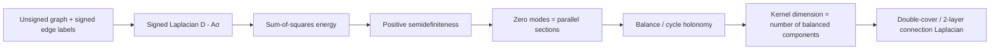

# The connection Laplacian enters Mathlib: a mathematical field guide

> **Purpose.** Explain, in ordinary mathematical language, how the existing
> Z/2 connection-Laplacian development can be factored into reusable Mathlib
> results. This guide is an orientation aid, **not** a proof certificate for
> the port. The canonical source formalization remains this repository.

**Work in progress:** [Mathlib fork and contribution branch](https://github.com/jesusvilela/mathlib4/tree/feat/signed-graph-laplacian).
**First proposed library module:**
[`SignedLapMatrix.lean`](https://github.com/jesusvilela/mathlib4/blob/feat/signed-graph-laplacian/Mathlib/Combinatorics/SimpleGraph/SignedLapMatrix.lean).

## Why the mathematical object belongs in a general library

A simple graph tells us *which* vertices can interact; an edge label tells us
*how values are transported*. The first Mathlib contribution uses existing
`SimpleGraph.EdgeLabeling` rather than importing the paper's entire
`ConnGraph` structure.

For a finite undirected graph `G=(V,E)`, give each edge a symmetric sign
`σ_uv ∈ {+1,-1}` (positive for ordinary edges, negative for *wrap* edges).
Define the signed adjacency and signed Laplacian:

```text
Aσ(u,v) = σ_uv  when {u,v} is an edge; otherwise 0
Lσ       = D - Aσ
```

Here `D` is the degree matrix. These definitions expose the operator
independently of the paper's double-cover and block-matrix constructions.

- All edges positive: `Lσ = L`, the usual graph Laplacian.
- All edges negative: `Lσ = D + A`, the **signless Laplacian**.
- Mixed signs: the same symmetric operator handles genuine Z/2 transport.

## The three transitions that matter



### 1. Energy: positivity is geometric, not numerical luck

For every real vector `x : V → ℝ`,

```text
xᵀ Lσ x = ½ Σ_u Σ_v [u~v] (x_u - σ_uv x_v)².
```

The double sum visits each undirected edge twice. Therefore each contribution
is a square and the operator is positive semidefinite.

An ordinary edge contributes `(x_u - x_v)²`; a wrap edge contributes
`(x_u + x_v)²`. The sign changes what it means for a vector to remain
locally constant, *not* the nonnegativity of its energy.

The source proof is in `ConnectionLaplacian/L13_PSD.lean`. The new Mathlib
proof is being adapted to Mathlib's current APIs and needs a successful
current-toolchain build before any claim of formal verification.

### 2. Null vectors are parallel sections

Since every summand is nonnegative, zero energy is equivalent to

```text
x_u = σ_uv x_v     on every edge {u,v}.
```

Combined with positive semidefiniteness, this is also the characterization
of the *operator* kernel `Lσ x = 0`. This is the local-to-global bridge:
along each connected path, values propagate with the product of edge signs.

On a closed walk, transport returns to the original vertex. A negative sign
product would require `x_u = -x_u`, hence `x_u = 0` over the reals.
Connectedness then propagates zero to the entire component.

### 3. Balance and dimension

A component is **balanced** if one can choose a vertex sign
`τ : V → {+1,-1}` so that

```text
σ_uv = τ_u τ_v       for every edge in the component.
```

Equivalently, the product of edge signs around **every closed walk** is +1;
equivalently, the wrap indicator is a Z/2 coboundary. This is the precise
meaning behind the cohomological formulation in `L6_Cohomology.lean`
and `L12_WalkH1.lean`.

On a balanced component, all parallel sections are of the form
`x_v = c τ_v`, so they form a one-dimensional real vector space. On an
unbalanced component, the only parallel section is zero. Consequently:

```text
dimℝ ker Lσ = number of balanced connected components of G.
```

This is the mathematical target of `L8_Recognition.lean` and of the
eventual second Mathlib contribution.

A useful related *gauge* viewpoint: for globally balanced `G`, the diagonal
matrix `T = diag(τ_v)` satisfies `T²=I` and `Lσ=T L T`.
Thus the **whole spectrum**, not only the kernel dimension, agrees with
that of the ordinary Laplacian in the globally balanced case. On disconnected
graphs this applies component by component where a gauge exists.

## The K4 warning: total wrap parity is NOT balance

A single total count of negative edges cannot detect all cycle obstructions.
For example, in `K4`, make only edges `{1,2}` and `{3,4}` negative.
There are **two** negative edges in total (even), but the triangle
`1-2-3-1` contains **one** negative edge (odd). This signing is unbalanced.

The earlier number-of-odd-wrap-components criterion is valid for a
single-cycle graph, where the cycle space has rank one, but not for a
general graph. The corrected invariant is the existence of a vertex gauge
on each component, or equivalently trivial sign holonomy on every cycle.

Never reintroduce the old total-parity criterion when porting to Mathlib.

## What is formally established, and what remains

| Layer | Status | Source or gate |
|---|---|---|
| Original Z/2 development | Repository-reported Lean verification at **v4.11.0** | `ConnectionLaplacian.lean`, `Hardening/`, its CI and evidence map |
| Current Mathlib definitions, symmetry, signless case | **Draft port** | Fork branch `feat/signed-graph-laplacian` |
| General energy, PSD and edgewise-kernel theorems | **Draft Lean proofs, not yet accepted by Lean** | Same fork branch; targeted fork CI |
| Balance classification in Mathlib | **Future port**, mathematically justified by source | The future gauge/holonomy and componentwise kernel proofs |
| Full two-layer connection Laplacian in Mathlib | **Future integration** | Keep its matrix identification and cover assumptions explicit |

A theorem's mathematical correctness, the fidelity of its Lean statement,
the acceptance of its proof by the current Lean kernel, and its suitability
for Mathlib are **four different checks**.

## Reproducible finite counterexample and energy audit

The dependency-free script
[`scripts/verify_signed_laplacian_small.py`](../scripts/verify_signed_laplacian_small.py)
checks **all** signed simple graphs on labeled vertex sets of size 1 through 4:
each potential unordered edge is absent, positive or negative (760 cases).
It uses exact rational Gaussian elimination rather than floating-point
rank thresholds.

Run:

```bash
python3 scripts/verify_signed_laplacian_small.py
```

A current direct execution of that script reported:

```text
PASS: 760 exact signed graphs, n=1..4
PASS: 59808 exact quadratic energy checks
PASS: 420 full-graph gauge conjugation checks
PASS: K4 balanced signings = 8; even-negative unbalanced signings = 28
```

The checks compare the signed-Laplacian nullity with the number of balanced
connected components; compare the matrix quadratic form with the edgewise
sum of squares for every vector with entries in `{-1,0,1}`; and verify
gauge conjugation when every component is balanced. They are independent
finite examples and regression checks (**measured evidence**), not
substitutes for the universally quantified Lean proofs.

## Review workflow

1. Compile the proposed module using the fork's `lean-toolchain`:
   `lake exe cache get` and
   `lake build Mathlib.Combinatorics.SimpleGraph.SignedLapMatrix`.
2. Check that the actual theorem statements reflect the mathematical
   definitions; resolve every compiler error without `sorry` or new axioms.
3. Run the relevant Mathlib linters, `lake exe mk_all --check`, and an
   explicit axiom audit where supported.
4. Keep the first upstream PR restricted to a maintainable foundation.
   The temporary `.github/workflows/signed-lap-ci.yml` belongs to the
   author's fork **only** and must not be included in the upstream patch.
5. Disclose AI assistance honestly and have the contributor personally
   review and explain the mathematics, definitions and Lean proofs.
   GitHub/Zulip discussions should be written by the contributor, in
   accordance with Mathlib's current policy.

The objective is not to transfer the entire research archive at once.
It is to expose the smallest stable operators and invariants that other
mathematicians can reuse, inspect and independently reconstruct.
